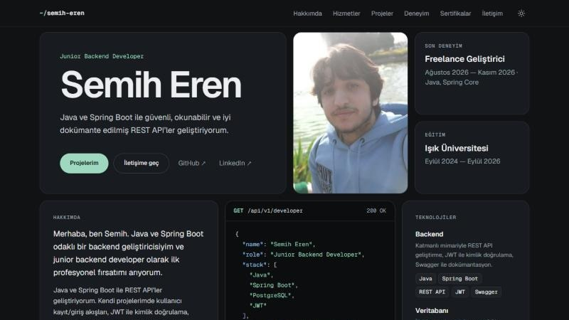
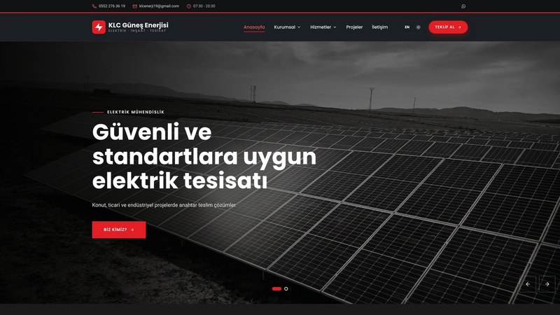
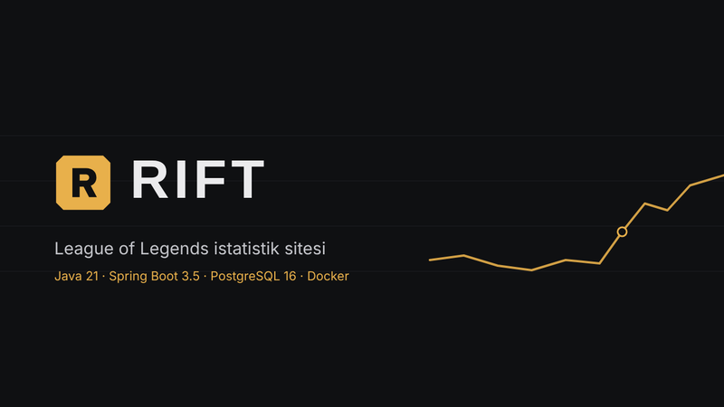
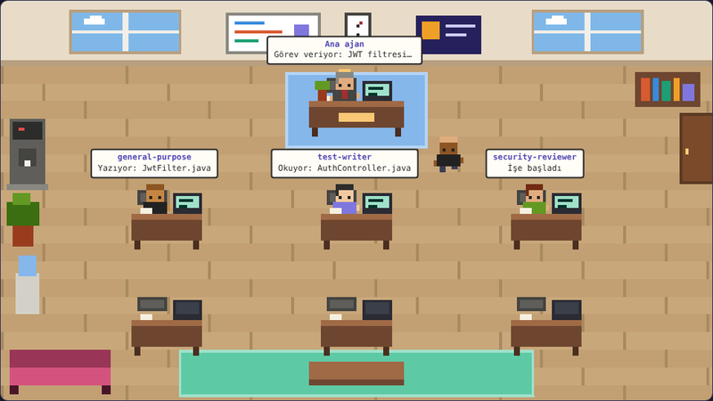

# Merhaba, ben Semih 👋

**Java ve Spring Boot** ile REST API'ler geliştiriyor, bunları kendi Linux sunucumda çalıştırıyorum. Kişisel sitem: **[semiheren.com](https://semiheren.com)**

- 🛠️ Şu an kişisel web sitemin backend'i olan **[site-api](https://github.com/Semiheren05/site-api)** üzerinde çalışıyorum
- 🌐 Portfolyo sitem semiheren.com'u ve admin panelini Spring Boot kullanmadan, Spring Framework ile yazdım: **[portfolio-showcase](https://github.com/Semiheren05/portfolio-showcase)**
- 🏢 Bir güneş enerjisi firması için yönetim panelli kurumsal site geliştirdim: **[kurumsal-site-showcase](https://github.com/Semiheren05/kurumsal-site-showcase)** · canlı: [klcenerjiinsaat.com](https://klcenerjiinsaat.com/)
- 🎮 Riot Games API üzerine Türkçe bir League of Legends istatistik sitesi yazdım: **[Rift-showcase](https://github.com/Semiheren05/Rift-showcase)** · canlı: [rift.semiheren.com](https://rift.semiheren.com)
- 🤖 Claude Code'un alt ajanlarının ne yaptığını piksel art bir ofiste canlı gösteren **[ajan-ofisi](https://github.com/Semiheren05/ajan-ofisi)**'ni geliştirdim (hook olayları, Server-Sent Events)
- 🗓️ Freelance ilanlarında sık istenen türde bir proje olarak **[randevu-api](https://github.com/Semiheren05/randevu-api)**'yi geliştirdim: işletmeler için çok işletmeli online randevu sistemi
- 📚 Her gün bir Java alıştırması yapıp testleriyle birlikte **[java-denemeler](https://github.com/Semiheren05/java-denemeler)**'e ekliyorum (şu an 41. gün: algoritmalar ve Big-O, eşzamanlılık ve virtual thread'ler, tasarım desenleri, reflection ile kendi doğrulama kütüphanem, Spring'siz mini DI kapsayıcısı, Dijkstra, kütüphanesiz JSON ayrıştırıcı, Bloom filtresi, refactoring katası, deadlock ve ReentrantLock, hız sınırlayıcı algoritmaları, saat dilimleri...)
- 🖥️ Projelerimi kendi Ubuntu ev sunucumda barındırıyorum (Docker, Nginx, Caddy)

## Teknolojiler

**Backend:** Java 21 · Spring Boot · Spring Security (JWT) · Spring Data JPA / Hibernate · REST · OpenAPI · Thymeleaf · Server-Sent Events
**Veri:** PostgreSQL · Flyway · SQL Server
**Test:** JUnit 5 · Mockito · AssertJ · Testcontainers · Playwright
**DevOps:** Docker · Docker Compose · GitHub Actions · Linux (Ubuntu) · Nginx · Git
**Diğer:** Astro · Tailwind CSS · JDA (Discord botları) · C# / .NET (Windows Forms) · HTML · CSS · JavaScript

## Vitrin

Kaynak kodu paylaşılmayan projelerimi (`-showcase` repoları) ekran görüntüleri, mimari şeması ve "neler öğrendim" notlarıyla anlatıyorum; ajan-ofisi açık kaynak.

<table>
  <tr>
    <td align="center" width="50%">
       
      <a href="https://github.com/Semiheren05/portfolio-showcase"><b>portfolio-showcase</b></a> 
      Kişisel sitem ve admin paneli: Boot'suz Spring 7, JDBC, JWT + iki adımlı doğrulama, Astro
    </td>
    <td align="center" width="50%">
       
      <a href="https://github.com/Semiheren05/kurumsal-site-showcase"><b>kurumsal-site-showcase</b></a> 
      Panelden yönetilen kurumsal site: Spring Boot 3.5, Thymeleaf, roller, medya kütüphanesi · <a href="https://klcenerjiinsaat.com/">klcenerjiinsaat.com</a>
    </td>
  </tr>
  <tr>
    <td align="center" width="50%">
       
      <a href="https://github.com/Semiheren05/Rift-showcase"><b>Rift-showcase</b></a> 
      League of Legends istatistik sitesi: Riot API, kayan pencere rate limiter, tilt ve duo analizi · <a href="https://rift.semiheren.com">rift.semiheren.com</a>
    </td>
    <td align="center" width="50%">
       
      <a href="https://github.com/Semiheren05/ajan-ofisi"><b>ajan-ofisi</b></a> 
      Claude Code alt ajanlarını piksel art ofiste canlı izleme: Spring Boot, SSE, PostgreSQL, canvas
    </td>
  </tr>
</table>

## Öne çıkan projeler

| Proje | Ne yapıyor | Teknolojiler |
|---|---|---|
| [portfolio-showcase](https://github.com/Semiheren05/portfolio-showcase) | Kişisel sitem [semiheren.com](https://semiheren.com) ve admin paneli: Spring Boot olmadan elle kurulan Spring, düz SQL, JWT + kütüphanesiz TOTP, çerezsiz istatistikler, Telegram bildirimleri, kendi sunucumda yayın (kodsuz vitrin) | Java 17, Spring Framework 7, Spring Security 7, PostgreSQL, Flyway, Astro, Testcontainers, Playwright |
| [kurumsal-site-showcase](https://github.com/Semiheren05/kurumsal-site-showcase) | Güneş enerjisi firması için kurumsal site ve yönetim paneli ([klcenerjiinsaat.com](https://klcenerjiinsaat.com/)): panelden yönetilen içerik, Türkçe/İngilizce, projeler haritası, medya kütüphanesi, roller (kodsuz vitrin) | Java 21, Spring Boot 3.5, Thymeleaf, PostgreSQL, Flyway, Docker, Caddy |
| [Rift-showcase](https://github.com/Semiheren05/Rift-showcase) | Türkçe League of Legends istatistik sitesi ([rift.semiheren.com](https://rift.semiheren.com)): maç geçmişi, canlı oyun, oturum ve tilt analizi, duo sinerjisi, arkadaş ligleri, maçın kırılma anı; iki pencereli rate limiter, her maçı bir kez çekip `jsonb` saklama, Discord/Telegram bildirimleri (kodsuz vitrin) | Java 21, Spring Boot 3.5, Thymeleaf, PostgreSQL, Flyway, Riot Games API, Docker, Nginx |
| [ajan-ofisi](https://github.com/Semiheren05/ajan-ofisi) | Claude Code'un hook olaylarını kaydedip alt ajanları piksel art bir ofiste canlı gösteren panel: Server-Sent Events, commit sonrası yayın, demo modu, gece temizliği | Java 21, Spring Boot 3.5, PostgreSQL, Flyway, SSE, JavaScript (canvas), Testcontainers, Docker |
| [site-api](https://github.com/Semiheren05/site-api) | Web sitemin backend'i: katmanlı mimari, etiketli ve aranabilir blog, portföy, JWT + dönen refresh token'lar, çerezsiz görüntülenme istatistikleri, hız sınırlı iletişim formu, N+1 testi, CI | Java 21, Spring Boot 3, PostgreSQL, Flyway, Testcontainers, Docker |
| [randevu-api](https://github.com/Semiheren05/randevu-api) | Çok işletmeli online randevu sistemi: çalışan bazında boş saat hesabı, çifte rezervasyonu engelleyen PostgreSQL kısıtı, tatil ve izin günleri, hatırlatma e-postaları, Stripe ile online ödeme ve iade, müşteri yorumları | Java 21, Spring Boot 3, PostgreSQL, Flyway, Stripe, Testcontainers, Docker |
| [java-denemeler](https://github.com/Semiheren05/java-denemeler) | Her gün bir Java alıştırması: her gün kendi paketinde, birim testleri ve "neler öğrendim" notlarıyla | Java 21, JUnit 5, Maven, GitHub Actions |
| [discord-bot](https://github.com/Semiheren05/discord-bot) | Discord moderasyon botu: ceza ve uyarı sistemi, destek talepleri, çekilişler, YouTube ve Kick duyuruları | Java 21, JDA, Gradle, GitHub Actions |
| [C-Sharp](https://github.com/Semiheren05/C-Sharp) | Şifreli sohbet uygulaması | C#, Windows Forms |

## Sırada

Kafka ve Redis ile olay tabanlı mikroservisler; Prometheus ve Grafana ile izleme.
